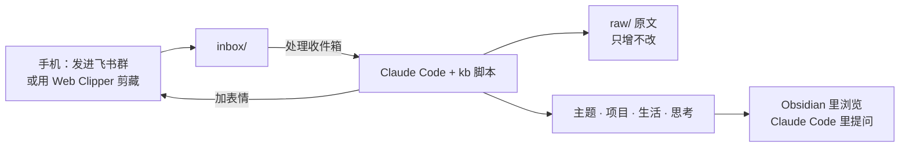

# second-brain-kit

一个随手往聊天框里丢东西、由 AI 每天整理成个人 wiki 的"第二大脑"。基于 Karpathy 提出的 [LLM-Wiki 模式](docs/llm-wiki.md)：

- **收集**：在手机上把链接、文件、想法发进飞书群，不改变任何习惯。
- **整理**：电脑开着时说一句"处理收件箱"，Claude Code 拉取消息、抓取网页正文、把内容编译进 Obsidian 里的主题页、项目页和生活页，每条要点都标明出处。
- **思考**：每次处理后只问你一个问题，你的回答以原话存进"思考"。AI 不代写你的观点。



> 📖 完整的使用说明（每天怎么用、升级会动什么、常见问题）见 **[docs/使用说明.md](docs/使用说明.md)**。

## 两部分

| | kit（本仓库） | vault（你的知识库） |
| --- | --- | --- |
| 是什么 | 脚本、规则模板、测试、文档 | 一个 Obsidian vault |
| 放在哪 | `~/second-brain-kit` | 默认放在 iCloud 的 Obsidian 文件夹，手机上也能看 |
| 内容 | 只有系统文件和虚构的示例数据 | 你的全部个人内容，**永远不会**进入本仓库 |
| 版本记录 | GitHub | 可选，默认关闭（见下文） |

处理进度（飞书游标、待加的表情、追问、体检日期）存在 vault 的 `.kb/state.json` 里，随 iCloud 同步，所以**任何一台装了 kit 的电脑都能接着处理收件箱**，不会重复拉取。飞书的 App Secret 和浏览器登录状态只存在每台电脑的 `~/.second-brain/`，不进 iCloud。

## 安装（约 15 分钟）

### 准备

一台 Mac，并装好：

- [Homebrew](https://brew.sh)，然后安装 Node.js 和 git：

  ```bash
  brew install node git
  ```

- [Claude Code](https://claude.com/claude-code)，并已登录；
- [Obsidian](https://obsidian.md)。想在手机上看笔记的话，在 iPhone 上安装 Obsidian，新建一个保存在 iCloud 的 vault，这样 Mac 上会出现 iCloud 的 Obsidian 文件夹。

### 安装

1. 下载 kit：

   ```bash
   git clone https://github.com/zhanlutuzi/second-brain.git ~/second-brain-kit
   ```

2. 在 kit 目录里启动 Claude Code：

   ```bash
   cd ~/second-brain-kit && claude
   ```

3. 输入 `/setup`，按提示一问一答。它会依次：
   - 检查 Node，安装依赖，让 `kb` 命令可用；
   - 安装抓取网页用的 Chromium；
   - 新建你的 vault，或者接入另一台电脑上已经建好的 vault；
   - 配置飞书（可以跳过，以后在 vault 里说"配置飞书"再接入）；
   - 在 `~/.zshrc` 里加一个 `kb-open` 命令；
   - 用 20 条虚构的示例数据试跑一次。

4. 用 Obsidian 打开 vault 文件夹，看看生成的页面。

<details>
<summary>不用 /setup，手动安装</summary>

```bash
cd ~/second-brain-kit && npm install && npm link && npx playwright install chromium
```

```bash
kb init "$HOME/Library/Mobile Documents/iCloud~md~obsidian/Documents/我的第二大脑"
```

接入飞书时，在 vault 目录运行：

```bash
kb config --app-id <App ID> --app-secret <App Secret> --chat-id <群 ID>
```

</details>

## 日常使用

打开终端，运行 `kb-open`（或者 `cd` 进 vault 后运行 `claude`），然后直接说：

| 你说 | 会发生什么 |
| --- | --- |
| 处理收件箱 | 拉取飞书消息、抓取链接正文、入库、给消息加表情、提交一次；最后给出处理报告和一个追问 |
| （回答追问） | 你的原话一字不改地记进 `思考/年-月.md`，并链接到相关页面 |
| 直接提问，例如"读书会小程序为什么延期" | 基于知识库回答，每个论断都附出处；知识库里没有就直说 |
| 把这个回答存下来 | 存成一个新的主题页 |
| 每周回顾 | 本周新增、你写下的话、观点变化、待回应的事项（只出报告，不改文件） |
| 体检 | 检查失效链接、重复和矛盾的页面等，给出建议清单，你确认后才修改 |
| 升级 | 等同于运行 `kb upgrade`：拉取新代码，更新系统文件；你的内容和设置不受影响 |

抓取不到的链接（例如需要登录的页面）会在报告里列出来。用 [Obsidian Web Clipper](https://obsidian.md/clipper) 剪藏，保存位置设为 vault 的 `inbox/` 文件夹，下次处理时会一并入库。

## 两台电脑

在第二台电脑上同样 clone kit、运行 `/setup`，选择"使用已有的 vault"，再填一次飞书凭证即可。之后两台电脑都能说"处理收件箱"。

- 不要两台同时处理。另一台电脑 10 分钟内刚处理过时，会提醒你等 iCloud 同步完再处理。
- 建议在 Finder 里右键 vault 文件夹，选"保留下载"，避免 iCloud 把文件只留在云端。
- 升级时，两台电脑都运行一次 `kb upgrade`（各自更新本机的程序；vault 只会被改一次）。

## 版本记录（可选）

默认不记录版本。想找回某个页面的旧版本，可以打开 Obsidian 的核心插件"文件恢复"（设置 → 核心插件 → 文件恢复）。

想要每次处理都留一个 git 提交，把 `我的设置.md` 里的 `version_history` 改成 `true`。历史存在每台电脑本机的 `~/.second-brain/vault.git`，vault 里不放任何 git 文件，所以不会被 iCloud 同步。两台电脑会各记各的；在一台上回滚时，另一台同步过来的修改也会被回滚，回滚前请确认。

## 接入飞书

在[飞书开放平台](https://open.feishu.cn)一次性完成以下配置，约 10 分钟：

1. 创建企业自建应用，添加"机器人"能力；
2. 在权限管理中开通：读取历史消息（im:message:readonly）、读取群组中的所有消息（im:message.group_msg）、获取消息中的资源文件（im:resource）、表情回复的写权限；
3. 创建版本并发布；
4. 把机器人拉进你的收件箱群；
5. 记下 App ID、App Secret 和群 ID（以 `oc_` 开头），在 vault 里说"配置飞书"填进去。

系统按需拉取消息，不需要配置事件订阅，也不需要公网地址。

## 知识库结构

```
我的第二大脑/
├── CLAUDE.md        规则（系统文件，升级时更新；末尾"个人补充"区块会保留）
├── 我的设置.md       个人配置：项目列表、生活分类、表情、批量上限等
├── index.md         总目录（自动生成）
├── log.md           处理记录，最新的在最上面
├── .kb/state.json   处理进度（Obsidian 里看不到），随 iCloud 同步
├── inbox/           待处理队列
├── raw/             原文，只增不改
├── 主题/ 项目/ 生活/ 思考/
└── _templates/      页面模板（系统文件）
```

规则详见 vault 里的 `CLAUDE.md`，设计详见 [docs/PRD.md](docs/PRD.md) 和 [docs/TECH.md](docs/TECH.md)。

## 常见问题

**`kb: command not found`**：在 kit 目录运行 `npm link`；报权限错误就运行 `sudo npm link`。

**公众号文章总是抓取失败**：确认装过浏览器（`cd ~/second-brain-kit && npx playwright install chromium`）。还不行，就在 `我的设置.md` 里把 `browser_headless` 改成 `false`，让浏览器显示出来，必要时手动完成一次验证；登录和验证状态会保存在 `~/.second-brain/browser`。

**飞书消息拉不下来**：在 vault 目录运行 `kb pull --dry-run`，看返回的 `message`。常见原因是权限没开通、版本没发布，或机器人不在群里。

**iCloud 里出现了"文件名 2.md"**：这是两台设备同时修改造成的冲突副本。说"体检"，会提示你合并。

**怎么升级**：在 vault 目录运行 `kb upgrade`，它会自己拉取新代码、安装依赖、更新系统文件，你的内容和设置不受影响。详见[使用说明·升级](docs/使用说明.md#八升级)。从 v0.1.0 升级的第一次，需要先在 kit 目录手动运行一次 `git pull && npm install`。

## 开发

需要 Node.js 20 及以上。所有测试离线运行，飞书接口和网页访问全部用 fixtures 模拟。

```bash
npm install
```

```bash
npm test
```

开发按 P0 → P4 分阶段进行，每个阶段一个 PR，详见 [docs/TECH.md](docs/TECH.md)"开发阶段与验收标准"。

## 许可证

[MIT](LICENSE)
