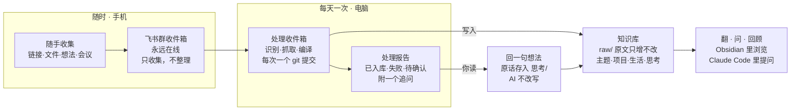

# 个人知识库系统 PRD（v0.1）

2026-10-28 · zhanlutuzi

> 本文由 claude.ai 上的原始文档导出为 Markdown，内容保持原文。原文中的嵌入图已改画为 Mermaid。与 [TECH.md](TECH.md) 不一致之处以 TECH.md 为准，并在对应位置用 ⚠️ 注明。

## 背景与要解决的问题

现状是把看到的好文章、软件资源和想法发到一个飞书群里，需要时再搜索。这个习惯收集成本极低，值得保留，但存在三个问题：

- **只有堆砌，没有结构**：内容按时间流排列，同一主题散落各处，无法串联。
- **只有输入，没有输出**：收藏后很少回看，自己的思考没有沉淀下来。
- **工作与生活信息割裂**：项目会议、个人思考、社保健康等事务没有统一的归处，复盘时难以追溯。

## 产品定位与设计原则

**一句话定位**：一个随手往聊天框里丢东西、由 AI 每天整理成个人 wiki 的第二大脑，基于 Karpathy 提出的 LLM-Wiki 模式，以 GitHub 模板仓库的形式开放给他人使用。

设计原则：

1. **收集零成本**：沿用现有习惯（发到飞书群），不增加任何操作。
2. **整理批量化**：不要求 24 小时运行，电脑开着时一条命令集中处理。
3. **AI 写、人读、人思考**：AI 负责归类、编译、链接；"我的观点"只记录用户原话，AI 不代写。
4. **简单、清晰、稳定**：结构固定且浅，规则写在文件里而不是窗口里，所有改动可回滚。
5. **系统与内容分离**：规则和命令可升级、可分享；个人内容只留在用户自己的仓库。

## 目标用户与核心场景

**目标用户**：习惯收藏但缺少整理的知识工作者，能在电脑上运行 Claude Code 一类的 AI 工具。第一位用户是我自己。

| 场景 | 用户在做什么 | 系统给出什么 |
| --- | --- | --- |
| 随手收集 | 在手机上把链接、文件、想法发进收件箱 | 无需任何反馈 |
| 每日整理 | 到公司后说一句"处理收件箱" | 入库清单、失败清单、一个追问 |
| 会议归档 | 把会议软件导出的原始记录转发进收件箱 | 决策与待办追加到对应项目页 |
| 查找与提问 | 在 Obsidian 里翻，或直接问 AI | 主题页，或带出处的回答 |
| 定期回顾 | 每周或每月一次 | 本周概览、观点变化、需要合并的页面 |
| 项目复盘 | 问"这个项目为什么延期" | 按日期排列、带原始纪要链接的决策时间线 |

## 核心流程



收集在手机上随时完成，整理由电脑上的一条命令集中完成。用户对追问的回复以原话写进"思考"，这是系统里唯一的输出环节。

每次处理的步骤：

1. 读取 log.md，确定上次处理到哪条消息。
2. 拉取新消息，识别为链接、文件、想法或会议记录。
3. 链接抓取正文；抓取失败的放进失败清单。
4. 原文存入 raw/，再查 index.md，更新或新建对应页面。
5. 更新 index.md 和 log.md，生成一次 git 提交。
6. 输出处理报告和一个追问。

> ⚠️ 已被 [TECH.md](TECH.md) 取代：游标改由 `~/.second-brain/state.json` 记录（第 1 步不再读 log.md）；index.md 改为由脚本 `kb index` 生成。

## 功能列表

MVP 只验证一件事：每天处理一次收件箱，是否比在飞书群里翻找更有用。

| 编号 | 功能 | 说明 | 阶段 |
| --- | --- | --- | --- |
| F1 | 收件箱拉取 | 通过飞书 CLI（⚠️ TECH.md：改为直接调用飞书开放平台 API）拉取上次处理之后的群消息；同时扫描 vault 内的 inbox/ 文件夹；处理后给消息加表情标记 | MVP |
| F2 | 内容识别与抓取 | 识别链接、文件、想法、会议记录四类；链接按三级策略抓取为 Markdown（见关键设计） | MVP |
| F3 | 编译入库 | 归入固定目录；优先更新已有主题页，没有才新建；原文存入 raw/ | MVP |
| F4 | 想法原话保留 | 用户的想法按日期记录原话，AI 只负责归位和链接 | MVP |
| F5 | 会议归档 | 识别会议记录，把决策和待办追加到项目页的决策日志 | MVP |
| F6 | 处理报告 | 列出已入库、抓取失败、需要确认的条目，外加一个追问 | MVP |
| F7 | 版本记录 | 每次处理生成一次 git 提交，可以回滚 | MVP |
| F8 | 提问 | 基于 wiki 回答问题，并附上来源页面 | MVP |
| F9 | 每周回顾 | 本周新增概览、观点变化、待回应的追问 | 后续 |
| F10 | 每月体检 | 找出重复页、过长页、孤儿页、前后矛盾的内容，用户确认后才修改 | 后续 |
| F11 | 首次配置向导 | /setup 一问一答生成个人设置，并测试收件箱连通 | 后续 |
| F12 | 模板仓库发布 | README、示例数据、可升级的系统文件 | 后续 |
| F13 | 手机端提问 | 需要 24 小时运行的服务，暂不做 | 远期 |

## 知识库结构

目录固定、层级浅，AI 不得擅自新建文件夹。归属关系靠链接表达，不靠文件夹。

```
我的第二大脑/                ← 即 Obsidian vault，放在 iCloud 的 Obsidian 文件夹
├── .obsidian/              Obsidian 自己的配置
├── CLAUDE.md               规则（来自模板，可升级）
├── 我的设置.md              个人配置（唯一需要你改的文件）
├── index.md                总目录（AI 维护；⚠️ TECH.md：改为脚本生成）
├── log.md                  处理记录，倒序，含收件箱游标（⚠️ TECH.md：游标移至 state.json）
├── inbox/                  手动剪藏的文件放这里
├── raw/                    原始资料，只增不改
│   ├── 2026/10/            按年/月存放
│   └── assets/             图片等附件
├── 主题/                   知识类主题页
├── 项目/                   一个项目一页，含决策日志
├── 生活/                   社保、健康、证件、软件清单等
└── 思考/                   按月一个文件，记录你的原话
```

| 页面类型 | 内容 | 更新方式 |
| --- | --- | --- |
| 主题页 | 一句话结论、要点、我的看法、相关链接、来源 | 同一主题持续更新，不重复建页 |
| 项目页 | 项目概况、决策日志（按日期）、待办、相关会议 | 每次会议追加 |
| 生活页 | 某件事务的流程、材料、经验 | 持续更新 |
| 思考日志 | 日期 + 原话 + 关联页面 | 只追加，不修改 |

### 页面格式（兼容 Obsidian）

Obsidian 读的就是普通的 Markdown 文件，上面的结构可以直接作为 vault 打开，中文文件夹名也没问题。为了让链接、搜索和图谱正常工作，所有页面遵守以下约定：

- **frontmatter**：每页开头是 YAML 属性，至少包含 type（主题 / 项目 / 生活 / 思考）、created、updated、sources（引用的 raw 文件）、tags。Obsidian 会把它显示为"属性"面板。
- **双链**：页面之间用 `[[页面名]]` 链接；引用原文用 `[[raw/2026/10/文件名]]`。
- **文件名**：不使用 `\ / : * ? " < > | # ^ [ ]` 这些字符，否则链接会失效。
- **可追溯**：主题页里每条要点后面都标注来源链接。这是社区实现的共识：wiki 必须能从 raw 重新推导出来。
- **观点分区**：来源的观点写在"要点"里，由 AI 总结并注明出处；"我的看法"只放你的原话。

一个主题页的样子：

```markdown
---
type: 主题
created: 2026-10-28
updated: 2026-10-30
sources: ["[[raw/2026/10/2026-10-28-长上下文会取代RAG吗]]"]
tags: [AI, 知识管理]
---
# RAG 与长上下文

## 一句话
个人规模的知识直接放进上下文更简单；团队规模仍需要检索。

## 要点
- 个人知识库通常能整体放进上下文窗口（[[raw/2026/10/2026-10-28-长上下文会取代RAG吗]]）

## 我的看法
- 2026-10-28：团队规模大，还是得用 RAG，个人的可以试试 wiki

## 相关
[[向量数据库]] · [[会员增长]]
```

### raw/ 怎么组织

- **路径**：raw/年/月/，文件名为"日期-标题.md"，例如 raw/2026/10/2026-10-28-长上下文会取代RAG吗.md。
- **frontmatter**：入库时写入来源 URL、类型（文章 / 文件 / 会议 / 想法）、收集时间、飞书消息 ID，再加一句话摘要。正文保持原样，之后不再修改。
- **膨胀问题**：纯文本很小，一千篇文章大约几十 MB，Obsidian 和 git 都能轻松处理。日常提问只读 index 和 wiki 页面，不会去翻 raw，所以 raw 变大不影响速度。真正占空间的是图片，统一放 raw/assets/，必要时可以单独清理。

### log.md 格式

倒序排列，最新的一次处理在最上面，打开文件就能看到最近发生了什么。每条记录的标题格式固定，方便检索：

```markdown
# 处理记录

收件箱游标：om_xxxx（2026-10-30 09:41）

## [2026-10-30] 处理收件箱 | 入库 7，失败 2
- 新建 [[RAG 与长上下文]]
- 更新 [[会员增长]]：追加 10/29 周会决策

## [2026-10-28] 处理收件箱 | 入库 12，失败 1
- ……
```

> ⚠️ 已被 [TECH.md](TECH.md) 取代：游标不再写在 log.md 里，改由 `~/.second-brain/state.json` 记录；log.md 只给人看。

## 关键设计（v0.2）

根据 v0.1 的评论，以下事项已有结论。

| 事项 | 结论 |
| --- | --- |
| 收件箱入口 | 首批只做飞书；另保留 vault 内的 inbox/ 文件夹，承接手动剪藏的文件 |
| 飞书账号 | 用个人飞书账号，不用实验室账号 |
| GitHub 仓库 | 公开的模板仓库，只放系统文件，不放任何个人内容 |
| 个人 vault | 存在 iCloud，用于多端同步；与模板仓库分开 |
| log.md | 倒序记录，最新的条目在文件顶部 |
| 追问 | 每次最多一个；用户不回复就跳过，不猜测、不记录 |
| 成功标准 | 连续使用两周，每个工作日至少处理一次收件箱 |

### 收件箱：怎么知道哪些消息已处理

- **游标**：log.md 记录上次处理到的最后一条消息的 ID 和时间。下次只拉取这之后的消息，不依赖已读或未读状态。（⚠️ TECH.md：游标改由 `~/.second-brain/state.json` 记录。）
- **可见标记**：处理成功的消息，由机器人加一个表情回复（例如 DONE）；抓取失败的加另一个表情。在手机上翻群时，一眼就能看出哪些已入库。飞书开放平台提供表情回复的添加、删除和查询接口。
- **消息保留**：个人版和基础版的消息只保留 18 个月，超过就无法查看和搜索。所以飞书群只是中转站，内容一经处理就存进本地 raw/，永久保留在自己手里，不需要为此付费。
- **待验证**：个人版飞书能否创建自建应用和机器人、能否读取群消息。开发前先实测。

### 链接抓取：三级策略

1. **直接抓取**：用 Defuddle 把网页转成 Markdown。Obsidian Web Clipper 的正文提取就是基于它，它是开源库，可以在任何环境运行，Claude Code 能直接调用。
2. **浏览器抓取**：公众号这类页面，问题不在解析，而在反爬，服务器端请求会被拦截。Web Clipper 能用，是因为它跑在你真实的浏览器里。第二级就是让 Claude Code 驱动一个真实浏览器打开页面，再交给 Defuddle 解析。
3. **手动兜底**：前两级都失败的，列进处理报告。你用 Web Clipper 剪藏，保存位置设为 vault 的 inbox/ 文件夹，下次处理时会一并入库。

### 模板仓库与个人 vault

- **两个东西**：GitHub 上的公开模板仓库，只包含规则、命令、页面模板和示例数据；你自己的 vault 是从模板复制出来的一份，放在 iCloud 的 Obsidian 文件夹里。Obsidian 的 vault 本质上就是一个普通文件夹。
- **不要把 git 仓库直接放进 iCloud**：iCloud 和 git 同时改动 .git 目录，容易出现同一分支两个 HEAD 之类的错误，社区有大量报告。个人 vault 的版本记录，把 .git 目录放到 iCloud 之外（git 的 separate-git-dir 用法），iCloud 只同步笔记本身。
- **忽略文件**：.obsidian/workspace.json 这类界面状态文件不进版本记录，它们是冲突的主要来源。

### 规则文件：Claude Code 怎么知道该怎么做

Claude Code 每次在 vault 文件夹里启动时，会自动读取根目录的 CLAUDE.md。所有"知识"都写在这里，不靠记忆：

- 目录结构，以及什么内容放哪里；
- 每种页面的模板和 frontmatter 字段；
- Obsidian 语法约定：`[[双链]]`、标签、文件名禁用字符；
- LLM-Wiki 的工作原则：raw 只增不改、优先更新已有页面、每个结论都能追溯到来源；
- 处理收件箱、提问、回顾、体检这四个命令的步骤。

Karpathy 的原始 llm-wiki 文档也放进仓库，作为背景参考。CLAUDE.md 是把它落到本系统的具体规则。

### 追问机制

- **目的**：把新内容和你已有的思考、项目连起来，逼出一句自己的话。这是系统里唯一的输出环节。
- **选题**：从本次入库的内容里，挑一条和你已有"思考"或在做项目最相关的，问一个问题。问题类型限三种：关联（这和某项目有关吗）、立场（你同意它哪一点）、行动（你打算用在哪）。
- **不回复**：直接跳过，不推测你的意思，也不写入任何页面。

### 主题页粒度

Karpathy 的原文刻意没有规定页面内容长什么样，社区实现大多按"概念"和"实体"建页。本系统的规则：

- 一页对应一个你会按名字去找的东西，例如"RAG""社保补缴"；
- 新内容先找最接近的已有页面去更新；同一话题积累到 2 个以上来源时，才单独建页；（⚠️ TECH.md 补充：这条指从已有页面拆出子话题；和任何已有页面都不相关的内容直接新建页面。）
- 一页超过约 2000 字，或明显包含两个独立的子话题时，在体检中提议拆分。

### 定期体检

- **什么时候做**：每次处理收件箱时检查，距离上次体检超过 30 天就提醒你运行一次。
- **查什么**：先做确定性检查（失效链接、孤儿页、缺失的 frontmatter、index 与实际页面不一致），再让 AI 查语义问题（重复页、前后矛盾、过时内容、过长页面）。
- **怎么改**：只出报告和合并建议，你确认后才动手修改。

## 不做什么

- 不做 24 小时常驻服务和实时入库（MVP 阶段）。
- 不做向量数据库或 RAG，个人规模直接读 wiki 文件。
- 不改变收集习惯，不要求打标签、不要求按格式发消息。
- AI 不代写、不润色用户的观点。

## v0.1 待讨论问题（结论见"关键设计"）

- [ ] 抓取失败的链接（公众号、小红书等）怎么补救：手动剪藏、转发正文，还是有更好的办法？
- [ ] 会议记录的数据边界：公司会议原文能否存进个人仓库？还是只存提炼后的个人思考？
- [ ] 敏感内容（社保、健康）是否推到 GitHub，默认排除哪些目录？
- [ ] 手机端怎么阅读：Obsidian 同步用 iCloud、Git 插件还是 Obsidian Sync？
- [ ] 主题页的粒度：多大的话题值得单独成页，什么时候合并？
- [ ] 追问机制：每次只问一个问题是否合适，用户不回复怎么处理？
- [ ] 收件箱适配：除飞书外，首批还支持哪些入口？
- [ ] 成功标准：试用多久、用什么信号判断这套系统值得继续？

## 仍待讨论

- [x] 个人版飞书能否创建机器人并读取群消息：可以，已实测（读取群消息、添加表情回复均正常）
- [ ] 会议记录的数据边界：公司会议原文能否存进个人 vault
- [x] 浏览器抓取用哪种方案：Playwright（见 TECH.md"链接抓取"），公众号文章已实测抓取成功

## Sources

- [Karpathy：llm-wiki 原文（gist）](https://gist.github.com/karpathy/442a6bf555914893e9891c11519de94f)
- [Denser.ai：LLM Wiki 社区实现综述](https://denser.ai/blog/llm-wiki-karpathy-knowledge-base/)
- [Defuddle（Web Clipper 的正文提取库）](https://github.com/kepano/defuddle)
- [飞书：消息存储常见问题](https://www.feishu.cn/hc/zh-CN/articles/543065627076)
- [飞书开放平台：表情回复概述](https://open.larkoffice.com/document/uAjLw4CM/ukTMukTMukTM/reference/im-v1/message-reaction/overview-of-message-reaction-resources.md)
- [git 仓库放在 iCloud 中的副作用](https://dev.to/architchandra/a-side-effect-of-storing-a-git-repository-in-icloud-drive-7ed)
