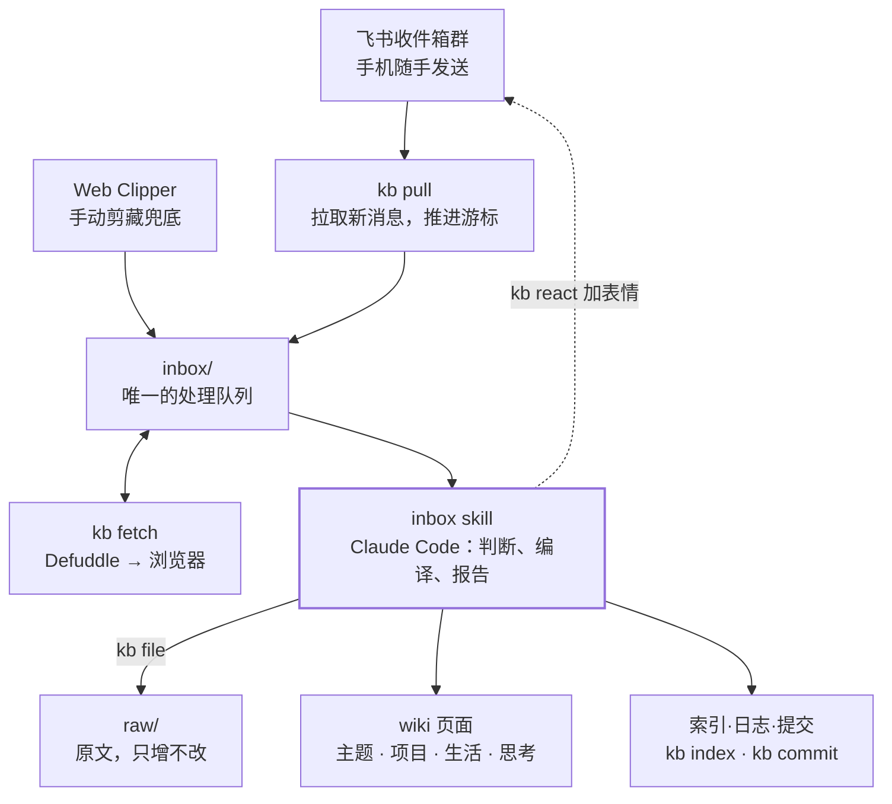

# 个人知识库系统 技术方案（v0.1）

2026-10-28 · zhanlutuzi

> 本文由 claude.ai 上的原始文档导出为 Markdown，内容保持原文。原文中的嵌入图已改画为 Mermaid。

## 概述

本文是 [个人知识库系统 PRD](PRD.md) 的实现方案，面向负责开发的云端 Claude Code。范围是 PRD 中标记为 MVP 的功能 F1–F8，外加 F9–F12 的骨架。

**前提**：用户已实测通过：个人飞书账号可以创建自建应用，机器人能读取收件箱群的消息并添加表情回复。

**核心设计原则：脚本负责确定性的输入输出，AI 负责判断。**

| 由脚本完成（Node.js，可测试） | 由 Claude Code 完成（写在 skill 里） |
| --- | --- |
| 拉取飞书消息、维护游标、下载附件 | 判断一条内容属于哪种类型 |
| 抓取网页并转成 Markdown | 决定更新哪个页面、写什么 |
| 移动文件、生成 index.md | 撰写主题页的要点、项目页的决策日志 |
| 失效链接、孤儿页等确定性检查 | 发现矛盾、重复，提出合并建议 |
| 给消息加表情、git 提交 | 生成处理报告和追问 |

这样划分有两个好处：凡是会出错的机械操作都可以写单元测试；AI 每次只需要做它擅长的判断，提示词更短，行为也更稳定。

**开发环境约束**：云端 Claude Code 访问不到用户的飞书账号、Mac 和 iCloud。所以所有脚本都要能用测试夹具（fixtures）离线测试，真实环境的联调由用户在本地完成。

## 总体架构



飞书消息和手动剪藏的文件都先变成 inbox/ 里的条目，只有 inbox skill 会写 wiki。名称以 kb 开头的都是脚本，行为确定；蓝色的框由 Claude Code 完成，负责判断。虚线表示处理结果以表情形式回写到飞书群。

## 代码与数据的存放

系统拆成两部分，分别放在两个位置：**kit**（代码，放在本机）和 **vault**（内容，放在 iCloud）。原因是脚本依赖的 node_modules 有成千上万个小文件，放进 iCloud 会拖慢同步、引发冲突，而手机上的 Obsidian 也用不到它们。

|  | kit | vault |
| --- | --- | --- |
| 是什么 | GitHub 上的公开模板仓库，clone 到本机 | 用户的知识库，即 Obsidian 的 vault |
| 位置 | ~/second-brain-kit | ~/Library/Mobile Documents/iCloud~md~obsidian/Documents/我的第二大脑 |
| 包含 | 脚本、依赖、vault 模板、测试、文档 | 规则、skill、内容 |
| 升级 | git pull | 运行 /setup --upgrade，从 kit 复制新的系统文件 |
| 版本记录 | GitHub | 本地 git，历史存在 ~/.second-brain/vault.git |

### kit 仓库结构

```
second-brain-kit/
├── README.md                  安装与使用说明
├── package.json               "type": "module"，Node 20+
├── bin/kb.mjs                 统一命令入口：kb <子命令>
├── src/
│   ├── feishu/                拉取消息、下载附件、加表情
│   ├── fetch/                 Defuddle 抓取 + 浏览器抓取
│   ├── vault/                 frontmatter 读写、移动文件、生成索引
│   ├── lint/                  确定性检查
│   └── state.mjs              状态文件读写
├── vault-template/            vault 的初始内容（见下）
├── examples/                  20 条示例收藏，用于演示和测试
├── test/                      vitest 单元测试 + fixtures
└── docs/
    ├── PRD.md
    ├── TECH.md                即本文
    └── llm-wiki.md            Karpathy 原文，作为背景参考
```

### vault 结构（由 vault-template 生成）

```
我的第二大脑/
├── .claude/
│   ├── settings.json          预授权 kb、git 命令
│   └── skills/                inbox / ask / review / lint / setup
├── .obsidian/
├── .git                       一个文本文件，指向 ~/.second-brain/vault.git
├── CLAUDE.md                  规则（系统文件）
├── 我的设置.md                 个人配置
├── index.md   log.md
├── inbox/   raw/   主题/   项目/   生活/   思考/
└── _templates/                四种页面模板
```

**系统文件与用户文件的边界**：CLAUDE.md、.claude/、_templates/ 属于系统文件，升级时会被覆盖；其余都属于用户文件，升级时绝不改动。CLAUDE.md 末尾留一个"个人补充"区块，升级时原样保留。

**状态与密钥不放进 vault**：机器状态（游标等）放在 ~/.second-brain/state.json，飞书 App Secret 放在 ~/.second-brain/.env。它们不该同步到手机，也不该进入版本记录。

## 模块设计

所有脚本通过统一入口 kb 调用，每个子命令都把结果以 JSON 输出到 stdout，供 skill 读取。**inbox/ 是唯一的处理队列**：飞书消息和手动剪藏的文件，都先变成 inbox/ 里的一个 .md 文件，后续流程只认 inbox/。

| 子命令 | 作用 | 输出 |
| --- | --- | --- |
| kb pull | 拉取飞书新消息，写入 inbox/，推进游标 | 新增条目列表 |
| kb fetch &lt;文件&gt; | 抓取条目中的链接正文，写回该文件 | 成功或失败及原因 |
| kb file &lt;文件&gt; | 把条目移入 raw/年/月/，规范文件名 | 新路径 |
| kb index | 根据 wiki 页面的 frontmatter 重新生成 index.md | 页面数 |
| kb lint | 运行确定性检查 | 问题列表 |
| kb react &lt;结果文件&gt; | 按处理结果给飞书消息加表情 | 成功数 |
| kb commit -m &lt;说明&gt; | 在 vault 中提交一次 | commit id |
| kb status | 待处理条数、上次体检日期、未回复的追问 | 状态摘要 |

### 飞书适配器（kb pull / kb react）

- **鉴权**：用 App ID 和 App Secret 换取 tenant_access_token，缓存到过期前 5 分钟。
- **拉取**：调用"获取会话历史消息"接口，参数为 container_id_type=chat、收件箱群 ID、start_time=游标时间、按创建时间升序，分页拉完。
- **权限**：im:message:readonly（读取历史消息）、im:message.group_msg（读取群内所有消息，不只是 @机器人的）、im:resource（下载文件和图片）、表情回复的写权限。
- **消息到条目的映射**：
  - 文本或富文本中含 URL：每个 URL 生成一个 link 条目，消息里的其余文字作为 note 保留；
  - 不含 URL 的文本：生成一个 thought 条目，正文原样保存；
  - 文件：下载到 inbox/，生成一个 file 条目；如果首行是"会议：项目名"，或文件名包含"会议""纪要"，标记为 meeting 候选；
  - 图片：下载到 inbox/，生成一个 image 条目；
  - 合并转发的聊天记录：展开为文本，生成一个 thought 条目；
  - 机器人自己发的消息和系统消息：跳过。
- **游标与去重**：条目文件名为 feishu-&lt;message_id&gt;.md，已存在就跳过。所有条目写入成功后才推进游标，中途失败重跑也不会重复或遗漏。由于 start_time 精确到秒，同一秒内的消息靠 message_id 去重。
- **表情标记**：入库成功和失败各用一个表情，emoji_type 在"我的设置"中可配置，默认值开发时按飞书表情列表确定。

**实现方式**：直接调用飞书开放平台 API（官方 Node SDK），不封装飞书 CLI。理由有三点：只需要拉取、下载、加表情三个接口，范围很小；用 fixtures 做离线测试更方便；模板的使用者可以少装一个工具。适配器只负责"把消息变成 inbox/ 条目"，以后要换成 CLI 实现，也只需替换这一个模块。

**用户需要在飞书开放平台完成的配置**（一次性，约 10 分钟）：

1. 创建企业自建应用，添加"机器人"能力；
2. 在权限管理中开通：读取历史消息、读取群组中的所有消息、获取消息中的资源文件、表情回复的写权限；
3. 创建版本并发布；
4. 把机器人拉进收件箱群；
5. 记下 App ID、App Secret 和群 ID（chat_id），由 /setup 写入配置。

因为采用定时拉取而不是实时推送，所以**不需要配置事件订阅，也不需要公网地址**。

### 链接抓取（kb fetch）

1. **直接抓取**：用桌面浏览器的 User-Agent 请求页面，再用 defuddle/node 配合 linkedom 解析为 Markdown，同时取出标题、作者、发布时间、站点名。
2. **浏览器抓取**：第一级失败，或域名在"直接走浏览器"名单里（默认包含 mp.weixin.qq.com），就用 Playwright 启动一个持久化的 Chromium（用户数据目录在 ~/.second-brain/browser，登录状态可以保留），等页面加载完，把 HTML 交给 Defuddle 解析。
3. **标记失败**：仍然失败，就在条目 frontmatter 写入 fetch_status: failed 和原因，由处理报告列出，等用户手动剪藏。

**判定失败的标准**：HTTP 状态非 2xx；正文少于 200 字；或者正文命中验证页特征词（如"环境异常""完成验证"）。

### 入库编译（由 inbox skill 驱动）

- **单次上限**：每次最多处理 30 个条目，剩余的留到下次，避免上下文过长。
- **步骤**：对每个条目依次判断类型 → kb file 存入 raw/ → 读 index.md，再用 ripgrep 按关键词搜索 wiki，找出候选页面 → 决定更新还是新建页面（规则见 PRD"主题页粒度"） → 编辑页面并加来源引用 → 记录本条做了什么。
- **类型与去向**：
  - 文章 → 主题页或生活页的"要点"；
  - 软件资源 → 生活/软件工具清单.md；
  - 想法 → 思考/年-月.md 追加原话，并在相关页面的"我的看法"里加链接；
  - 会议 → 项目页的"决策日志"和"待办"。
- **幂等**：raw/ 里已有相同 source_url 或 message_id 的条目，视为重复，跳过并在报告中注明。

### 索引与体检（kb index / kb lint）

index.md 改为**脚本生成**，不再由 AI 维护（与 PRD v0.2 的不同之处）：按页面类型分组，每页一行，内容是链接、一句话摘要、更新日期，按更新时间倒序排列。这样它永远和实际页面一致。

kb lint 的确定性检查包括：失效的双链；没有任何入链的孤儿页；缺少必填 frontmatter 字段的页面；文件名含禁用字符；页面超过 2000 字；raw/ 中被修改过的正文（与入库时记录的哈希值对比）。语义层面的检查由 lint skill 完成。

## 数据格式

### inbox 条目

```yaml
---
source: feishu            # feishu | clipper（Web Clipper 剪藏的文件没有这一项，处理时补上）
message_id: om_xxx
sent_at: 2026-10-28T08:20:11+08:00
kind: link                # link | thought | file | image | meeting
url: https://...
note: 用户随消息附带的文字
fetch_status: ok          # ok | failed | skipped
fetch_error: ""
---
（抓取到的正文，或想法原文，或文件转出的文本）
```

### raw 文件（在 inbox 条目的基础上补充）

```yaml
title: 长上下文会取代 RAG 吗
author: ...
published: 2026-10-20
site: ...
captured: 2026-10-28
summary: 一句话摘要（AI 写入）
body_sha256: ...          # 正文哈希，体检时用来检查 raw 正文是否被改过
```

### wiki 页面

```yaml
---
type: 主题                # 主题 | 项目 | 生活 | 思考
title: RAG 与长上下文
summary: 个人规模的知识直接放进上下文；团队规模仍需检索
created: 2026-10-28
updated: 2026-10-30
sources: ["[[raw/2026/10/2026-10-28-长上下文会取代RAG吗]]"]
tags: [AI, 知识管理]
---
```

四种页面的正文结构固定，写在 vault 的 _templates/ 中：

| 类型 | 正文小节 |
| --- | --- |
| 主题 | 一句话 · 要点（每条带来源） · 我的看法 · 相关 |
| 项目 | 概况 · 决策日志（日期倒序） · 待办 · 相关会议 |
| 生活 | 一句话 · 流程或要点 · 材料与链接 · 经验 · 相关 |
| 思考 | 按日期排列的原话，每条后附关联页面链接；只追加，不修改 |

### 状态文件 ~/.second-brain/state.json

```json
{
  "feishu": { "cursor_time": 1761611411, "last_message_id": "om_xxx" },
  "last_lint": "2026-10-01",
  "pending_question": { "asked_at": "2026-10-28", "text": "...", "related": "[[RAG 与长上下文]]" }
}
```

### 我的设置.md

结构化配置放在 frontmatter 里，正文留给用户写备注。

```yaml
---
feishu_chat_id: oc_xxx
reactions: { ok: OK, failed: CRY }      # 默认值待开发时确认
browser_domains: [mp.weixin.qq.com, xiaohongshu.com]
projects: [会员增长, 数据平台]
life_categories: [社保医保, 健康, 证件与办事, 软件工具]
batch_limit: 30
lint_interval_days: 30
---
```

### log.md

格式沿用 PRD：倒序排列，每次处理一条，标题为"## [日期] 操作 | 摘要"。游标不再写在 log.md 里，改由 state.json 记录；log.md 只给人看。

## 命令设计

每个命令是 vault 中 .claude/skills/&lt;名称&gt;/SKILL.md 下的一个 skill，用户可以输入 /inbox 调用，也可以直接说"处理收件箱"，由 skill 的 description 触发。skill 只写流程和判断规则；页面格式、目录约定统一写在 CLAUDE.md 里，不在各个 skill 中重复。

| skill | 触发说法 | 阶段 |
| --- | --- | --- |
| inbox | 处理收件箱 | MVP |
| ask | 直接提问，例如"会员增长为什么延期" | MVP |
| review | 每周回顾 | 后续 |
| lint | 体检、整理一下知识库 | 后续 |
| setup | 首次安装、升级 | 后续 |

### inbox

1. 运行 kb status。如果有未回复的追问，先把它展示给用户；用户这次没回应，就清除它，不做任何记录。
2. 运行 kb pull。
3. 对 inbox/ 中 kind 为 link、且还没抓取过的条目，逐个运行 kb fetch。
4. 按"入库编译"的步骤处理条目，最多 batch_limit 条。抓取失败的条目留在 inbox/，不入库。
5. 运行 kb index；在 log.md 顶部写入本次记录。
6. 运行 kb react 标记飞书消息，再运行 kb commit。
7. 输出处理报告：已入库（每条一行，写明去了哪个页面）、失败（附原因和原链接）、待确认，最后附一个追问，并写入 state.json。
8. 距离上次体检超过 lint_interval_days 天，就在报告末尾提醒一句。

### ask

先读 index.md 定位相关页面，再按需读取页面和它们引用的 raw 文件，最后作答。每个论断都要附上 [[页面]] 链接。wiki 里找不到依据时直接说"知识库里没有"，不用常识补充冒充知识库内容。用户要求"把这个回答存下来"时，存为新的主题页，sources 指向引用过的页面。

### review

读取最近 7 天的 log.md 和思考日志，输出：本周新增概览（按页面和主题统计）、本周用户写下的原话、与以往看法存在冲突的地方（附双方链接）、未回应的追问。只输出报告，不修改任何文件。

### lint

先运行 kb lint 拿到确定性问题，再由 AI 检查语义问题：重复的页面、前后矛盾的要点、过时的内容、需要拆分的长页面。所有修改都以"建议清单"的形式给出，用户逐条确认后才执行，执行完运行 kb index 和 kb commit，并更新 state.json 中的 last_lint。

### setup

首次安装时：

1. 检查 Node 20+ 和 git，在 kit 目录执行 npm install；
2. 询问 vault 放在哪里，默认是 iCloud 的 Obsidian 目录；
3. 把 vault-template 复制过去，用 separate-git-dir 初始化 git；
4. 引导用户填写飞书 App ID、App Secret 和群 ID，写入 ~/.second-brain/.env 和"我的设置"；
5. 运行一次 kb pull --dry-run，测试连通性；
6. 在 ~/.zshrc 中加一个 kb-open 函数，用来进入 vault 目录并启动 Claude Code。

加 --upgrade 参数时，只用 kit 中的新版本覆盖系统文件。

## 版本控制、同步与密钥

- **vault 的 git**：用 git init --separate-git-dir ~/.second-brain/vault.git 初始化。iCloud 里只有一个指向该目录的 .git 文本文件，历史记录不进入 iCloud。
- **vault 的 .gitignore**：.obsidian/workspace*.json、.obsidian/cache、.DS_Store、inbox/ 下的二进制附件。
- **kit 的 .gitignore**：node_modules/、.env、任何 vault 内容；只有 examples/ 中的示例数据可以提交。
- **提交粒度**：每次 inbox 或 lint 结束时提交一次，提交说明与 log.md 的标题一致，方便对照和回滚。
- **密钥**：App Secret 只保存在 ~/.second-brain/.env，文件权限设为 600；脚本在日志和输出中一律打码。
- **权限预授权**：vault 的 .claude/settings.json 放行 kb *、git 和 rg 命令，减少日常运行时的确认弹窗；删除文件不在放行范围内。
- **iCloud 冲突**：手机和电脑同时修改同一页面时，iCloud 可能生成"文件名 2.md"这类副本。kb lint 会检测这类文件，并提示用户合并。

## 开发阶段与验收标准

共分五个阶段，每个阶段单独提交 PR，通过验收后再进入下一阶段。P1 结束时用户就能开始试用，后面的阶段边用边加。

| 阶段 | 内容 | 验收标准 |
| --- | --- | --- |
| P0 骨架 | kit 仓库结构、vault-template、CLAUDE.md、四种页面模板、kb 命令框架、vitest | npm test 通过；kb --help 能列出全部子命令；vault-template 用 Obsidian 打开没有报错 |
| P1 本地闭环 | kb file / index / lint / commit / status；inbox skill（只处理 inbox/ 文件夹）；ask skill | 用 examples/ 的 20 条示例跑一次 inbox：全部进入 raw/ 且 frontmatter 完整；至少生成 5 个主题页，每条要点都有来源；kb lint 零报错；重复运行不会重复入库 |
| P2 飞书 | kb pull / react；附件下载；游标与去重 | 用录制的 API 响应做的 fixtures 测试通过；用户本地实测：20 条真实消息全部入库并加上表情，重跑没有重复 |
| P3 抓取 | kb fetch 的两级抓取；失败判定；浏览器域名名单 | fixtures 中的 10 个常见站点 HTML 都能解析出正文；用户本地实测公众号文章抓取成功率 ≥ 80% |
| P4 完善 | review、lint、setup skill；README；GitHub 发布 | 在一台全新的 Mac 上照着 README 操作，15 分钟内完成安装并跑通示例 |

**给开发者的约定**：

- 开发开始前，先把 PRD 和本文导出为 Markdown，放进 docs/；
- 每个阶段开工前，先提交该阶段的实现计划，用户确认后再写代码；
- 所有对飞书接口和网页的访问都要能被 mock，测试不依赖网络；
- 本文与实现有出入时，先更新本文再改代码。

## 风险与待定事项

| 风险 | 影响 | 应对 |
| --- | --- | --- |
| 公众号反爬策略升级，浏览器抓取也失败 | 手动剪藏的工作量上升 | 保留第三级手动兜底；统计失败率，持续超过 20% 时再评估其他方案 |
| AI 入库时归错页面，或重复建页 | 知识库逐渐变乱 | 优先更新已有页面的规则；index 由脚本生成；定期体检；每次提交都可回滚 |
| iCloud 同步延迟或冲突 | 页面出现副本 | 只在电脑端运行处理；lint 检测冲突副本 |
| 单次处理的条目过多，超出上下文 | 处理中断或质量下降 | batch_limit 上限；未处理的条目留在 inbox/，下次继续 |
| 飞书接口权限或配额变化 | 无法拉取消息 | 只依赖 inbox/ 这个唯一队列，飞书适配器可以单独替换 |

**待定**：

- [ ] 表情回复的默认 emoji_type（开发 P2 时按飞书表情列表确定）
- [ ] 会议记录原文能否存入个人 vault（PRD 遗留问题，不影响开发）
- [ ] Playwright 浏览器以有头还是无头模式运行（P3 实测后决定）

## Sources

- [Defuddle：CLI 与 Node.js 用法](https://github.com/kepano/defuddle)
- [飞书开放平台：表情回复概述](https://open.larkoffice.com/document/uAjLw4CM/ukTMukTMukTM/reference/im-v1/message-reaction/overview-of-message-reaction-resources.md)
- [飞书权限示例（im:message.group_msg 等）](https://pypi.org/project/agentica-gateway/)
- [Karpathy：llm-wiki 原文](https://gist.github.com/karpathy/442a6bf555914893e9891c11519de94f)
